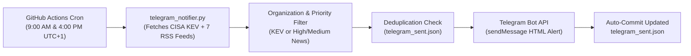

# Security Pulse — Telegram Bot Integration Guide

This guide explains how to obtain the required Telegram credentials (`TELEGRAM_BOT_TOKEN` and `TELEGRAM_CHAT_ID`) and outlines everything required to implement automated security alerts for watched organizations (**Google, Microsoft, GitHub, Linux, Android, Apple, Fortinet, Cisco, AWS, Zoom, Slack, Apache, Nginx, Adobe, Mozilla, Docker**).

---

## 1. Architecture Overview



* **Zero LLM Token Cost:** Alerts send formatted summaries and links directly from CISA KEV and RSS feed metadata, using **0 Groq API tokens**.
* **Zero Paid Infrastructure:** Runs 100% free on GitHub Actions and the Telegram Bot API.
* **Zero New Dependencies:** Uses `requests` and `beautifulsoup4`, which are already installed in [`backend/requirements.txt`](file:///C:/DailyBread/security-pulse/backend/requirements.txt).

---

## 2. Step-by-Step: How to Get Your Telegram Details

You only need two values from Telegram: **`TELEGRAM_BOT_TOKEN`** and **`TELEGRAM_CHAT_ID`**. The entire setup takes ~3 minutes.

### Step 1: Create Your Bot & Get `TELEGRAM_BOT_TOKEN`

1. Open Telegram (desktop or mobile) and search for the official verified bot: **`@BotFather`**.
2. Click **Start** (or send `/start`), then send the command:
   ```text
   /newbot
   ```
3. **Choose a display name** when prompted (e.g., `Security Pulse Alerts`).
4. **Choose a unique username** that ends in `bot` (e.g., `security_pulse_alerts_bot`).
5. `@BotFather` will reply with an HTTP API token formatted like this:
   ```text
   7123456789:AAH_xYz1234567890abcdefGHIJKLMN_opq
   ```
   Copy and save this value — this is your **`TELEGRAM_BOT_TOKEN`**.

---

### Step 2: Get Your `TELEGRAM_CHAT_ID`

First, trigger a single test message in the destination where you want the bot to post:

| Destination Type | What to Do in Telegram | Expected Chat ID Format |
| :--- | :--- | :--- |
| **Option A: Personal DM** *(1-on-1 with Bot)* | 1. Click the `t.me/<your_bot_username>` link from BotFather.<br>2. Click **Start** and send a message like `hello`. | Positive integer (e.g. `123456789`) |
| **Option B: Team Group Chat** | 1. Open your Telegram Group → **Add Members** → add your bot.<br>2. Send a message mentioning the bot in the group (e.g. `/test@your_bot_username`). | Negative integer (e.g. `-1001234567890`) |
| **Option C: Broadcast Channel** | 1. Open Channel Info → **Administrators** → **Add Admin** → add your bot with **Post Messages** enabled.<br>2. Post any test message in the channel. | Negative integer (e.g. `-1009876543210`) or `@channelusername` (if public) |

Immediately after sending that message, open your web browser and visit (replacing `<YOUR_BOT_TOKEN>` with your token from Step 1):

```text
https://api.telegram.org/bot<YOUR_BOT_TOKEN>/getUpdates
```

Look for the `"chat": { "id": ... }` object in the JSON response:

```json
{
  "ok": true,
  "result": [
    {
      "update_id": 83920192,
      "message": {
        "message_id": 2,
        "chat": {
          "id": -1001234567890,
          "title": "SecOps Threat Alerts",
          "type": "supergroup"
        },
        "text": "/test@security_pulse_alerts_bot"
      }
    }
  ]
}
```

Copy the number in `"id"` (**including the leading `-` minus sign** if it is a group or channel). That is your **`TELEGRAM_CHAT_ID`**.

> [!TIP]
> If `"result": []` is empty when you visit `/getUpdates`, send one more message in your chat/group/channel and refresh the browser tab.

---

### Step 3: Verify Your Credentials (10-Second PowerShell Test)

You can verify that your bot can post to your chat right away from PowerShell before adding any code:

```powershell
Invoke-RestMethod -Uri "https://api.telegram.org/bot<YOUR_BOT_TOKEN>/sendMessage" `
  -Method Post -ContentType "application/json" `
  -Body '{"chat_id": "<YOUR_CHAT_ID>", "text": "✅ Security Pulse Bot is connected!"}'
```

---

### Step 4: Store the Credentials

1. **Local Environment (`backend/.env`):**
   Add these two lines to [`backend/.env`](file:///C:/DailyBread/security-pulse/backend/.env):
   ```env
   TELEGRAM_BOT_TOKEN=7123456789:AAH_xYz1234567890abcdefGHIJKLMN_opq
   TELEGRAM_CHAT_ID=-1001234567890
   ```
2. **GitHub Actions Secrets (for scheduled cloud runs):**
   In your GitHub repository, go to **Settings → Secrets and variables → Actions → New repository secret** and create:
   * `TELEGRAM_BOT_TOKEN`
   * `TELEGRAM_CHAT_ID`

---

## 3. What Implementation Entails in the Codebase

Implementing this requires **no changes to your existing frontend or FastAPI endpoints**. It adds three small files:

| File Path | Size | Purpose |
| :--- | :--- | :--- |
| `backend/telegram_notifier.py` | ~220 lines | Imports `fetch_vulnerabilities`, `filter_recent_vulnerabilities`, and `fetch_rss_news` from [`backend/main.py`](file:///C:/DailyBread/security-pulse/backend/main.py), filters by watched organizations and priority, checks deduplication state, and posts formatted alerts to Telegram. |
| `backend/telegram_sent.json` | ~10 lines | Lightweight state file storing previously sent URLs and CVE IDs (capped at the most recent 1,000 items) so the bot never sends duplicate alerts. |
| `backend/.github/workflows/telegram_digest.yml` | ~45 lines | GitHub Actions workflow that runs at 9:00 AM and 4:00 PM UTC+1 (`0 8,15 * * *`) + manual `workflow_dispatch`, executes `telegram_notifier.py`, and commits updates to `telegram_sent.json`. |

### 3.1 Organization Watchlist & Keyword Matching

To avoid false positives (e.g., `"apple"` matching `"applet"`, or `"Cisco IOS XE"` matching `"Apple iOS"`), `telegram_notifier.py` uses case-insensitive word-boundary regexes (`\b...\b`) across each watched organization and its core product ecosystem:

| Watched Organization | Matched Keywords & Product Lines |
| :--- | :--- |
| **Google** | `google`, `chrome`, `chromium`, `google workspace`, `gcp`, `google cloud`, `v8` |
| **Microsoft** | `microsoft`, `windows`, `exchange`, `azure`, `entra`, `sharepoint`, `office 365`, `microsoft 365`, `microsoft office`, `active directory`, `hyper-v`, `defender` |
| **GitHub** | `github`, `actions/checkout`, `github actions`, `dependabot`, `codespaces`, `copilot` |
| **Linux** | `linux`, `kernel`, `ubuntu`, `debian`, `red hat`, `rhel`, `openssh`, `sudo`, `systemd`, `glibc` |
| **Android** | `android`, `google play`, `play store`, `pixel`, `qualcomm`, `apk` |
| **Apple** | `apple`, `iphone`, `ipad`, `ipados`, `macos`, `safari`, `webkit`, `xcode`, `airdrop`, `icloud`, `ios` *(excluding Cisco IOS)* |
| **Fortinet** | `fortinet`, `fortios`, `fortigate`, `fortimanager`, `fortianalyzer`, `fortiproxy`, `fortiweb`, `forticlient` |
| **Cisco** | `cisco`, `ios xe`, `ios xr`, `nx-os`, `anyconnect`, `meraki`, `webex`, `splunk` |
| **AWS** | `aws`, `amazon web services`, `amazon s3`, `ec2`, `eks`, `lambda`, `cloudfront` |
| **Zoom** | `zoom`, `zoom workplace` |
| **Slack** | `slack` |
| **Apache** | `apache`, `tomcat`, `struts`, `activemq`, `log4j`, `ofbiz`, `superset`, `airflow`, `kafka` |
| **Nginx** | `nginx` |
| **Adobe** | `adobe`, `coldfusion`, `acrobat`, `magento`, `adobe commerce`, `experience manager` |
| **Mozilla** | `mozilla`, `firefox`, `thunderbird` |
| **Docker** | `docker`, `docker hub`, `docker desktop`, `containerd`, `runc`, `moby` |

### 3.2 Filtering Rules (Preventing Alert Fatigue)

1. **CISA KEV Matches:** Any newly added CISA KEV vulnerability matching a watched organization is **always** alerted (since CISA KEV entries are confirmed actively exploited).
2. **RSS News Matches:** An article is alerted only if it matches at least one watched organization **AND** has a priority of **`High`** or **`Medium`** (skipping `"Low"` priority general news/opinion articles).
3. **Deduplication:** Each CVE ID (`CVE-YYYY-NNNN`) and article URL is checked against `backend/telegram_sent.json` before sending and recorded immediately after delivery.
